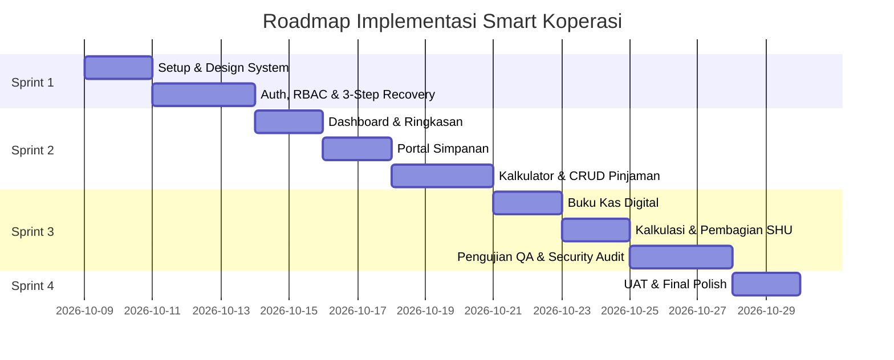

# Rencana Kerja & Task Breakdown: Smart Koperasi

Dokumen ini memetakan seluruh tugas pengembangan sistem **Smart Koperasi** berdasarkan [prd_project_brief_smart_koperasi.md](file:///d:/Test/Tugas/prd_project_brief_smart_koperasi.md), dibagi per sprint, modul fungsional, dan penanggung jawab teknis.

---

## 👥 Matriks Tim & Tanggung Jawab
- **Project Leader:** Rayhan Setya Dwi Putranto *(Koordinasi milestone & approval)*
- **Frontend Developer:** Fauzan Mukhlish *(UI/UX, Design System, Client API integration)*
- **Backend Developer:** Ghania Syafika *(API, DB Schema, JWT/RBAC, Business Logic & Security)*
- **Quality Assurance (QA):** Fitri Choirun Nisa *(Validasi logika, Testing fungsional & regresi)*

---

## 📅 Roadmap & Breakdown Task

---

### 🚀 Sprint 1: Pondasi, Design System & Otentikasi Terpadu

| ID Task | Judul Task | Modul / Komponen | PIC | Status |
| :--- | :--- | :--- | :--- | :---: |
| **TSK-101** | Inisialisasi Project Frontend (Vite + React TS) | Setup Lingkungan & Dependensi | Frontend | ✅ *Selesai* |
| **TSK-102** | Implementasi Design System & Styling Token | `index.css` (Font Plus Jakarta Sans, Deep Emerald `#0F5A47`, Warm Gold `#F4B400`) | Frontend | ✅ *Selesai* |
| **TSK-103** | Komponen App Shell & Navigasi Terpadu | Navbar `h-16` (64px), Active Tab Indicator, Header Utility (Badge status, Notif dot, Profil, Quick Logout) | Frontend | ✅ *Selesai* |
| **TSK-104** | Halaman Login Role-Based & Brute Force Lock | Toggle Anggota vs Pengurus, Show/Hide password, simulasi proteksi 5x salah | Frontend / Backend | ✅ *Selesai* |
| **TSK-105** | Halaman Pendaftaran Anggota Baru (Register) | Form NIK (16 digit), KTP, WA, Password Strength Meter, persetujuan syarat, status awal *Pending Approval* | Frontend | ✅ *Selesai* |
| **TSK-106** | Alur Pemulihan Akun 3-Langkah (Password Recovery) | Step 1 (Input Email) $\rightarrow$ Step 2 (OTP 6-digit countdown 60s) $\rightarrow$ Step 3 (Reset Password baru min 8 char) | Frontend | ✅ *Selesai* |
| **TSK-107** | State Management Auth, Sesi & Logout Modal | Simpan token JWT (mock/storage), sliding session, konfirmasi modal logout | Frontend | ✅ *Selesai* |

---

### 💳 Sprint 2: Core Member, Simpanan & CRUD Pinjaman

| ID Task | Judul Task | Modul / Komponen | PIC | Status |
| :--- | :--- | :--- | :--- | :---: |
| **TSK-201** | Dashboard Ringkasan Finansial Anggota | Kartu Total Simpanan, Sisa Pinjaman & Jatuh Tempo, Estimasi SHU berjalan, Quick Actions, Feed mutasi terkini | Frontend | ✅ *Selesai* |
| **TSK-202** | Portal Simpanan Anggota | Tab klasifikasi (Pokok, Wajib, Sukarela), tracker kepatuhan simpanan wajib bulanan, filter transaksi debit/kredit | Frontend | ✅ *Selesai* |
| **TSK-203** | Kalkulator Simulasi Pinjaman Interaktif | Slider plafon & tenor (bulan), pilihan bunga Flat/Menurun, perhitungan otomatis instan (< 1 detik) | Frontend | ✅ *Selesai* |
| **TSK-204** | Kartu Plafon & Checklist Kelayakan Pinjaman | Visual limit plafon (Rp 50jt), status skor kredit Prima A+, checklist syarat pengajuan pinjaman | Frontend | ✅ *Selesai* |
| **TSK-205** | CRUD Portofolio Pinjaman Lengkap | - *Create*: Formulir pengajuan baru + upload berkas - *Read*: Detail pinjaman, jadwal cicilan & sisa pokok - *Update*: Pengajuan perubahan tenor/restrukturisasi - *Delete*: Pembatalan draf pinjaman belum diproses | Frontend / Backend | ✅ *Selesai* |

---

### 📊 Sprint 3: Buku Kas Digital, Kalkulasi SHU & QA Testing

| ID Task | Judul Task | Modul / Komponen | PIC | Status |
| :--- | :--- | :--- | :--- | :---: |
| **TSK-301** | Buku Kas Digital Anggota & Rekapitulasi Arus Kas | Catatan uang masuk & uang keluar, saldo berjalan, filter waktu dan tipe mutasi | Frontend | ✅ *Selesai* |
| **TSK-302** | Fitur Ekspor Data Akuntansi | Fitur cetak/unduh format PDF & Excel laporan mutasi kas berstandar akuntansi | Frontend | ✅ *Selesai* |
| **TSK-303** | Modul Transparansi Perhitungan SHU | Visualisasi rincian Jasa Modal vs Jasa Usaha/Anggota berdasarkan kontribusi | Frontend | ✅ *Selesai* |
| **TSK-304** | Simulator Proyeksi Pembagian SHU (RAT) | Kalkulator dividen proyeksi akhir tahun buku berdasarkan simpanan dan transaksi pinjaman | Frontend | ✅ *Selesai* |
| **TSK-305** | Pengujian Fungsional, Security & Regresi UI | Form validation audit, boundary test kalkulator pinjaman, testing flow password recovery, responsive check | QA | ✅ *Selesai* |

---

### 🎯 Sprint 4: Finalisasi, UAT & Peluncuran

| ID Task | Judul Task | Modul / Komponen | PIC | Status |
| :--- | :--- | :--- | :--- | :---: |
| **TSK-401** | UAT & Kepatuhan Standar Akuntansi Koperasi | Verifikasi dengan standar SAK ETAP & Permenkop UKM | QA / PM | ⏳ *Pending* |
| **TSK-402** | Optimalisasi Performa & Polish Antarmuka | Validasi First Contentful Paint < 1.2 detik, micro-interactions, dark/light contrast check | Frontend | ⏳ *Pending* |
| **TSK-403** | Panduan Pengguna & Handover Dokumentasi | Dokumentasi panduan operasional anggota dan pengurus koperasi | Tim | ⏳ *Pending* |
